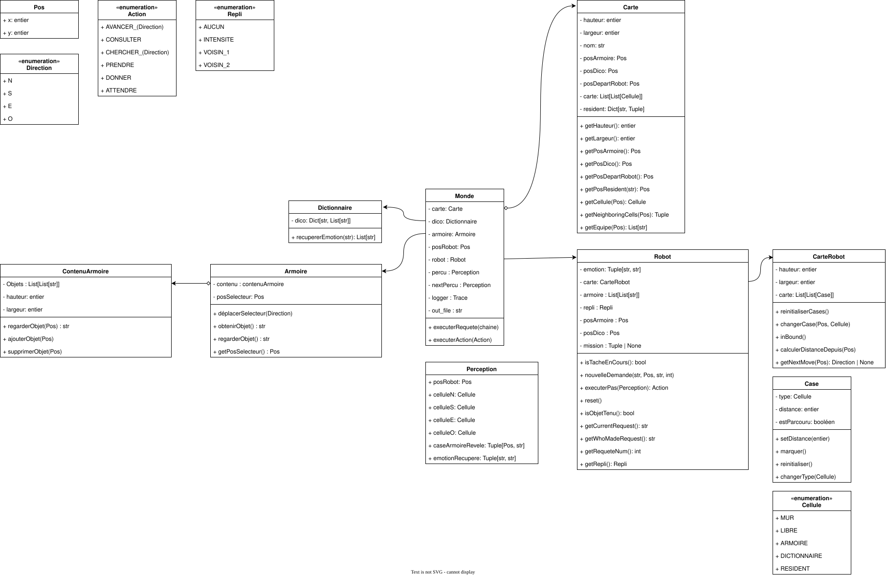

# Rapport projet de POA/SMA

Auteurs : 

- Rathgeber-Kivits Eloi, [eloi.rathgeber-kivits@etu.umontpellier.fr](mailto:eloi.rathgeber-kivits@etu.umontpellier.fr)

- Soares--Quebriac Kélig, [kelig.soares-quebriac@etu.umontpellier.fr](mailto:kelig.soares-quebriac@etu.umontpellier.fr)

M1 Imagine

<u>**Table des matières :**</u>

[TOC]

## Architecture

Ci-dessus, vous pouvez retrouver le diagramme de classe utilisé par notre architecture. Nous y retrouvons la classe monde, qui est le chef d'orchestre du programme. Elle dispose de l'ensemble des informations connus. Pour chaque requête, elle va construire un objet "Perception" contenant les différentes informations obtenues par le robot ce tour, l'envoyer au robot qui va alors évaluer quel action faire. Suite à cela, elle va vérifier si l'action du robot est valide, et si c'est le cas, appliquer les changements nécessaire sur le monde.

Nous avons veillé à ce que le robot n'ait aucun accès à la classe Monde : sa représentation de la carte est complètement distincte de celle de Monde, et les positions qui lui sont envoyés le sont faits en copie, ainsi le robot ne peut en aucun cas modifier sa position ou les cases du monde, seul la classe Monde en est capable. Une stratégie similaire a été adopté pour l'armoire.

## Stratégie de replanification

En cas de découverte d'un mur, le robot va replanifier l'ensemble de sa trajectoire. Soit $l$ la largeur de la carte et $h$ sa hauteur, l'algorithme utilisé pour planifier la trajectoire du robot a alors une complexité $\in O(l \times h)$. Cependant, bien que ce ne soit pas reflété dans le code, nous avons réfléchi à comment éviter de recalculer l'ensemble des cases. 

Nous avions pensé à créer un graphe de dépendance, où chaque case serait associé à la case lui ayant donné sa distance à l'objectif. Ainsi si une case venait à se transformer en mur, la chaîne de dépendance nous permettra de dire précisément quels cases ont été affectés.

## Critique de la règle de repli

Nous pensons que cela peut se défendre car la distance entre deux émotions sur la roue semble représenter une distance psychologique aux émotions, il parait raisonnable de dire que le dégoût est plus proche de la colère que de la confiance.

Cependant les objets qui sont associés à chacune de ces émotions ne vont pas nécessairement respecter cette distance là : si quelqu'un se sent moyennement triste et que le robot apporte un déodorant, cette personne pourrait mal le prendre.

Quelque chose de plus approprié pourrait être d'associer à chaque objet la liste des émotions/intensité auxquels il est apte à répondre, mais cela rendrait le rangement et la navigation au sein de l'armoire plus compliqué.

## Échecs de notre robot

### Échec 1 : Calcul inutile du parcours

Comme évoqué dans la partie "Stratégie de replanification", notre robot va recalculer à chaque tour le chemin en effectuant un parcours en largeur, même si l'immense majorité de la carte reste valide.

Le nombre de calcul est donc bien plus élevé que nécessaire, et dans une application réelle, on pourrait considérer que la consommation d'énergie de notre robot est loin d'être optimale. 

Une amélioration serait possible en construisant un graphe de dépendance comme évoqué précédemment.

### Échec 2 : l'armoire invalide valide

Le robot va automatiquement assumer sans vérifier que les objets sont au bon endroit dans l'armoire. Si un objet de peur se trouve dans la colonne de la joie il ne sourcillera pas. 

La plupart des autres vérifications sont bien effectués cependant : on s'assure que chacune des émotions attendues soient présentes et qu'elles correspondent à ce qu'il y a de décrit dans le fichier, de même pour les intensités, mais il n'y a pas de vérification quant à la position de ces émotions tant qu'elles sont dans les coordonnées "valides" ($0 \leq x \leq 7$ et $0 \leq y \leq 2$).

### Échec 3 : Mauvaise interprétation du message

L'analyse de sentiment est actuellement très limité : seul un premier mot identifié dans une liste de mot est pris en compte. On peut supposer qu'un résident qui envoie "Je ne suis pas triste" s'attendrait à recevoir un objet de joie faible/moyenne, mais le robot identifiera seulement le mot triste et renverra un objet correspondant à "tristesse moyenne". 

Une amélioration possible déjà pourrait être de prendre en compte la négation, si les mots "ne" et "pas" sont détectés par exemple, alors on prend l'émotion opposé sur la roue par rapport à ce qu'on aurait fait avec l'implémentation actuelle.